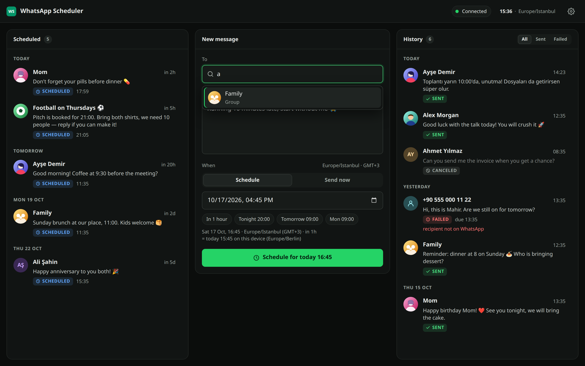

# WhatsApp Scheduler

**Schedule WhatsApp messages from your own personal WhatsApp account.** A tiny self-hosted web app, plus an MCP server so you can just tell Claude Code, Codex or the Claude mobile app *"send Mom 'happy birthday' tomorrow at 9"*.

- Log in, pick a contact or group, write the message, pick a time. Done.
- Works with your **normal WhatsApp account** (linked like WhatsApp Web, by scanning a QR code). No WhatsApp Business API, no Meta developer account.
- Your phone does not need to be online at send time.
- Runs on your own computer, server or Raspberry Pi. Nothing goes through a third-party service.
- MCP tools for Claude Code, Codex and any other MCP client, locally over stdio or remotely over HTTP.

WhatsApp itself is built on [wacli](https://github.com/openclaw/wacli), an open-source WhatsApp command-line client. This project doesn't touch the WhatsApp protocol; it's a scheduler and a UI on top of wacli.

<p align="center"></p>

> [!WARNING]
> WhatsApp does not officially support third-party clients, and using one can get your number banned. The risk is low if you only send a few personal messages to people who know you, and high for bulk or unsolicited messages. **Do not use this for marketing or spam.** This project is not affiliated with WhatsApp or Meta.

## Quick start

You need [Node.js](https://nodejs.org) 20 or newer.

```sh
npx whatsapp-scheduler
```

Or from a clone:

```sh
git clone https://github.com/mahirozdin/whatsapp-scheduler.git
cd whatsapp-scheduler
npm install
npm start
```

1. Open <http://localhost:3737>.
2. Log in. A password is generated on first start. Print it with `npx whatsapp-scheduler password`.
3. Click **Show QR code**. On your phone, open WhatsApp, go to **Settings → Linked devices → Link a device**, and scan the code. If the page is open on the same phone, use the pairing-code option instead.
4. Schedule messages.

On first start, the matching [wacli release](https://github.com/openclaw/wacli/releases) is downloaded and checksum-verified for you. If `wacli` is already on your `PATH`, or `WACLI_BIN` is set, that one is used instead. The scheduler links its own WhatsApp device and keeps its own wacli store, so it won't interfere with any other wacli setup you have.

Messages are sent only while the scheduler is running, so run it on a machine that stays on (see [Run it in the background](#run-it-in-the-background)).

## Use it from Claude Code, Codex or any MCP client

The scheduler exposes these MCP tools:

| Tool | What it does |
| --- | --- |
| `get_status` | Current time, your selected timezone, and whether WhatsApp is linked |
| `find_recipient` | Search contacts and groups by name or number |
| `schedule_message` | Schedule a message, or send it now |
| `list_messages` | List scheduled, sent and failed messages |
| `cancel_message` | Cancel a message that hasn't been sent yet |

Keep the scheduler running (`npx whatsapp-scheduler`), then connect your assistant.

### Easiest: open this folder

The repository ships with `.mcp.json` (Claude Code) and `.codex/config.toml` (Codex). Clone it, run `npm install`, start the scheduler, then open the folder in Claude Code or Codex and ask:

> Send "I'm on my way" to the Family group in 10 minutes.

### Claude Code (any folder)

```sh
claude mcp add --scope user whatsapp-scheduler -- npx -y whatsapp-scheduler mcp
```

### Codex

```sh
codex mcp add whatsapp-scheduler -- npx -y whatsapp-scheduler mcp
```

### Other MCP clients

Run `npx whatsapp-scheduler mcp` as a stdio server. It reads the token from the local config and forwards to the running scheduler, so it needs no settings.

You can also use the HTTP endpoint at `http://localhost:3737/mcp` with the header `Authorization: Bearer <token>`. Print the token with `npx whatsapp-scheduler token`.

## Use it from your phone with Tailscale

[Tailscale](https://tailscale.com) gives your devices a private network, so you can reach the scheduler from your phone without opening a port on your router. Install Tailscale on the machine running the scheduler and on your phone, signed in to the same account.

### The web UI, privately

```sh
tailscale serve --bg 3737
```

Open `https://<machine-name>.<your-tailnet>.ts.net` on your phone. Only your own devices can reach it.

### Claude on your phone (remote MCP)

The Claude mobile app connects to MCP servers through Anthropic's cloud, so the endpoint must be reachable from the internet. [Tailscale Funnel](https://tailscale.com/kb/1223/funnel) does that over HTTPS without opening a port:

```sh
tailscale funnel --bg 3737
npx whatsapp-scheduler token   # prints the secret MCP path
```

In Claude (web or desktop), go to **Settings → Connectors → Add custom connector** and use this URL:

```
https://<machine-name>.<your-tailnet>.ts.net/mcp/<token>
```

The connector then also shows up in the Claude mobile app.

> [!IMPORTANT]
> Funnel makes the scheduler public. The token in that URL is the only thing protecting your WhatsApp, so treat it like a password, and use a strong `WA_SCHEDULER_PASSWORD` because the login page is public too. To rotate the token, delete `token` from the config file and restart. To turn Funnel off again, run `tailscale funnel reset`.

## Run it in the background

### Linux (systemd)

```ini
# ~/.config/systemd/user/whatsapp-scheduler.service
[Unit]
Description=WhatsApp Scheduler
After=network-online.target

[Service]
ExecStart=/usr/bin/env npx -y whatsapp-scheduler
Restart=on-failure

[Install]
WantedBy=default.target
```

```sh
systemctl --user daemon-reload
systemctl --user enable --now whatsapp-scheduler
sudo loginctl enable-linger "$USER"   # keep it running while you're logged out
```

### macOS / Windows

Use any process manager, for example [pm2](https://pm2.keymetrics.io): `pm2 start "npx whatsapp-scheduler" --name whatsapp-scheduler && pm2 save`.

## Configuration

| Variable | Default | |
| --- | --- | --- |
| `PORT` / `HOST` | `3737` / `127.0.0.1` | Listen address. Keep `127.0.0.1` behind Tailscale Serve/Funnel. |
| `WA_SCHEDULER_PASSWORD` | generated | Web UI password |
| `WA_SCHEDULER_TOKEN` | generated | API and MCP token |
| `WA_SCHEDULER_DATA` | `~/.local/share/whatsapp-scheduler` | Data directory: config, settings, messages, profile pictures, wacli session |
| `WA_SCHEDULER_MAX_DELAY_MINUTES` | `60` | If the scheduler was down at send time, still send up to this many minutes late; after that, mark the message as missed |
| `WACLI_BIN` | auto | Use a specific wacli binary |

The timezone used to read send times is a setting in the web UI (stored in `settings.json`); it defaults to the server's timezone. A send time without a UTC offset, from the UI, the API or MCP, is wall-clock time in that timezone, with daylight saving time handled.

The data directory is `~/Library/Application Support/whatsapp-scheduler` on macOS and `%APPDATA%\whatsapp-scheduler` on Windows. It holds your WhatsApp session keys, so keep it private.

## How it works

- `wacli sync --follow` keeps one linked-device connection open. Each due message is sent with `wacli send text`, which hands it to that connection right away.
- Scheduled messages are stored in `messages.json`. A timer fires at the exact time of the next message, and a check every 5 seconds acts as a safety net.
- Due messages are spaced at least 5 seconds apart.
- Profile pictures of contacts and groups are cached in `avatars/`. wacli can only look them up while `sync` is stopped, and each lookup opens its own short WhatsApp connection. To keep that rare, at most 5 pictures are looked up at a time: once right before `sync` starts (your most recent chats), and then, by pausing `sync`, for the remaining recent chats and the contacts you search for or schedule: first about 5 minutes after startup, then at most every 30 minutes. So pictures fill in gradually. A pause usually takes 5-15 seconds and at most about a minute; messages sent in the meantime wait for it and go out right after. The pictures are downloaded after `sync` is back. Lookups never happen while you are linking or unlinking, while a message is sending, or when a message is due within 2 minutes.
- A message that fails is never retried automatically. If the scheduler stops in the middle of a send, that message is marked as failed rather than resent, so nobody gets a duplicate.
- "Sent" means WhatsApp accepted the message, not that it was delivered.

## Development

```sh
npm install
npm test   # runs against a fake wacli, no WhatsApp account needed
```

## License

[MIT](LICENSE). WhatsApp is a trademark of WhatsApp LLC. This project is not affiliated with, endorsed by, or connected to WhatsApp or Meta.
